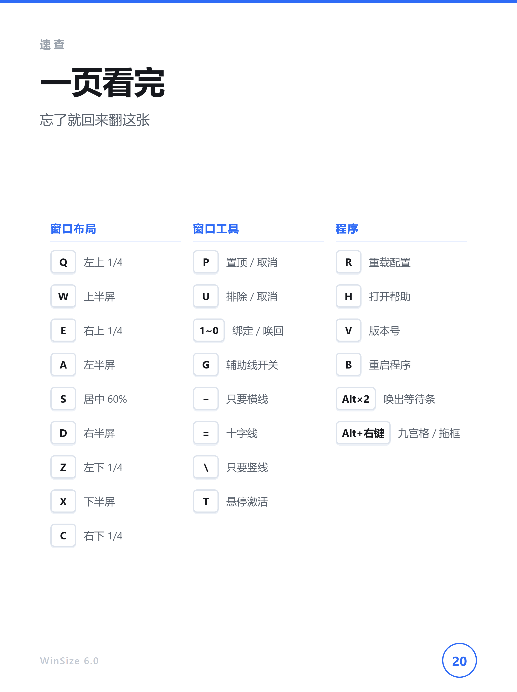

# WinSize 6.0

**双击左 Alt，按一个键，窗口就到你要的位置。**

`Q W E / A S D / Z X C` 与九宫格同形——键位的样子就是窗口的样子，不用背口诀。
所有操作都发生在"按下 Alt 之后"的那几秒：字母摆窗口、数字存书签、`P` 置顶、`G` 辅助线。
它也能被脚本或 AI 指挥，一句话摆好一整套桌面。



> 完整的使用说明在 **[帮助站](https://dmscode.github.io/WinSize/)**，
> 那个站点就是这份仓库里的 `help/` 渲染出来的。

## 获取程序

WinSize 是付费软件，在这里获取：

**https://afdian.com/item/61ce0baae17711f1b21552540025c377**

绿色版，解压即用，删掉文件夹就是卸载。不写注册表（开机自启除外）、不装服务、不上传任何信息。

## 系统要求

| 项 | 要求 |
| --- | --- |
| 系统 | Windows 11 x64（仅在此环境完整验证；Windows 10 未实测） |
| 运行时 | 不需要装 AutoHotkey，`WinSize.exe` 自带 |
| 权限 | 普通用户即可，不需要管理员 |

## 快速上手

1. 运行 `WinSize.exe`，托盘出现图标，**没有主窗口**，这是正常的。
2. **双击左 Alt**（半秒内按两下），屏幕底部出现一条 `WAITING`。
3. 按 `A`，当前窗口贴到左半屏；按 `D`，贴到右半屏。

默认配置开箱即用：九个方案、九个按键、九个鼠标区一一对应，尺寸全按屏幕百分比算，
换分辨率、加显示器都不用改配置。

## 文档

| 想找什么 | 去哪看 |
| --- | --- |
| 第一次用 | [帮助站 · 三十秒上手](https://dmscode.github.io/WinSize/) |
| 按了没反应 / 窗口摆不到位 | [常见问题](https://dmscode.github.io/WinSize/help/#/17-常见问题) |
| 布局规则、多显示器 | [03 布局方案](https://dmscode.github.io/WinSize/help/#/03-布局方案) |
| 改键位、改配置 | [05 按键绑定](https://dmscode.github.io/WinSize/help/#/05-按键绑定)、[15 配置文件](https://dmscode.github.io/WinSize/help/#/15-配置文件) |
| 让脚本或 AI 调用 | [16 第三方调用](https://dmscode.github.io/WinSize/help/#/16-第三方调用) |

## 关于升级

程序**不会自己下载或替换任何东西**，升级仍然是你下载新包、解压覆盖。

它只做一件事：启动 60 秒后读一次版本号，之后每 24 小时一次。发现新版本时，
**托盘菜单最上面**会多出一条 `【新版本 x.y.z 可用】`，点它打开获取页面。

整个过程只读取一个几十字节的文本文件，不发送任何关于你的信息。
不想让它查，就在设置里关掉「自动检查更新」——关掉之后完全不联网。

版本号的约定：第二位变化说明修了影响较大的问题，建议更新；最后一位一般是小改动。

## 这个仓库里有什么

```
├─ index.html      官网首页（GitHub Pages 的入口）
├─ help/           使用帮助，Markdown 原文件
├─ images/         功能说明图（21 张）
├─ videos/         宣传片（横版 + 竖版）
├─ assets/         首页样式、docsify 运行时
└─ version.txt     版本号，程序据此判断有没有新版
```

**只放文档与素材，不含程序源码。** 源码是私有仓库，不对外公开。

## 关于价格

不背刺老用户——没有特殊情况不会有降价和折扣，随时都是最好的价格。
